# 鸟羽集 · Bird Gallery Studio

> **面向观鸟人、生态摄影师与自然记录者的跨时代深色桌面影像工作台 & 个人生涯鸟种图鉴引擎**  
> **支持平台**：Windows 10 / 11 (`x64`) · macOS Apple Silicon (`M1 / M2 / M3 / M4`) · macOS Intel (`x86_64`)

---

## 目录

- [一、产品定位与核心设计理念](#一产品定位与核心设计理念)
- [二、系统架构概览](#二系统架构概览)
- [三、六大功能模块详细说明](#三六大功能模块详细说明)
  - [模块 1：多维图库导航与零卡顿磁盘原片直览](#模块-1多维图库导航与零卡顿磁盘原片直览)
  - [模块 2：专业级暗房选片工作台与 10 步撤销引擎](#模块-2专业级暗房选片工作台与-10-步撤销引擎)
  - [模块 3：生僻字拼音检索引擎与一图多鸟共存归类](#模块-3生僻字拼音检索引擎与一图多鸟共存归类)
  - [模块 4：点亮式个人生涯鸟种图鉴（Life-List Field Guide）](#模块-4点亮式个人生涯鸟种图鉴life-list-field-guide)
  - [模块 5：中国观鸟记录中心 & eBird 全渠道鸟单深度联动](#模块-5中国观鸟记录中心--ebird-全渠道鸟单深度联动)
  - [模块 6：地理鸟点地图、虚拟相册集与结构化导出](#模块-6地理鸟点地图虚拟相册集与结构化导出)
- [四、下载安装与跨平台启动指南](#四下载安装与跨平台启动指南)
- [五、全局快捷键速查表](#五全局快捷键速查表)
- [六、开发者指南与项目目录结构](#六开发者指南与项目目录结构)

---

## 一、产品定位与核心设计理念

在野外拍摄数千张连拍原片（JPG + RAW）后，观鸟摄影师往往面临三大痛点：**传统看图软件不懂鸟类分类学与生僻字拼音**、**整理归档容易破坏原始存储目录**、**观鸟记录单（中国观鸟记录中心 / eBird）与相机照片彼此割裂**。

**鸟羽集（Bird Gallery Studio）** 围绕“选片 → 识鸟归类 → 关联观鸟报告 → 点亮生涯图鉴 → 多维检索导出”完整闭环设计：

1. **非破坏性原片管理（Non-Destructive Cataloging）**：绝不强制移动、重命名或篡改磁盘原图文件；基于本地高性能 SQLite（WAL 并发日志模式）构建轻量索引，支持**一图多鸟共存**与**一图归属多个虚拟相册**。
2. **观鸟报告驱动的极速归类流**：自动匹配拍摄当日的个人观鸟报告，一键从当日鸟单中按拼音首字母勾选鸟种，并自动将报告中的省、市、观鸟点回填至照片元数据。
3. **Obsidian & Kingfisher 次世代深色视觉语言**：采用 `#0B0E14` 暗房级画布底座搭配 `#10B981` 翠鸟绿交互主色与高对比悬浮控件，长时间审阅高动态羽毛细节不刺眼、不偏色。

---

## 二、系统架构概览

```mermaid
flowchart LR
    subgraph Input["数据输入层"]
        RAW["相机原片 JPG / PNG / WebP\n全系 RAW (CR3/NEF/ARW/RAF/ORF/DNG)"]
        BR["中国观鸟记录中心\n导出 Excel/CSV · 报告链接/ID · 鸟单文本"]
        EB["eBird 官方生态\nMyEBirdData.csv · S 清单号 · L 热点"]
    end

    subgraph Core["核心业务引擎 (Python + SQLite WAL)"]
        IO["极速影像与 EXIF/GPS 解码器\n(内嵌预览秒读 + 清晰度评估)"]
        TAX["双名录分类与拼音引擎\n(1,416 中国鸟种 / 11,012 世界鸟种)"]
        CL["个人观鸟记录服务\n(按报告编号拆分 · 同日优先匹配)"]
        UNDO["10 步有界事务撤销栈\n(快照级回溯单张/批量操作)"]
    end

    subgraph Studio["原生深色桌面工作台 (PySide6 + QtWebEngine)"]
        NAV["左侧：五维图库目录树\n+ 零卡顿磁盘文件直览"]
        VIEW["中央：HiDPI 网格视图 / 单图放大检视\n/ 点亮式生涯鸟种图鉴"]
        INSP["右侧：星标旗标 / 多鸟共存归类\n/ 同日报告联动 / 交互地图选点"]
    end

    Input --> Core --> Studio
```



---

## 三、六大功能模块详细说明

### 模块 1：多维图库导航与零卡顿磁盘原片直览

| 子功能 | 详细说明 |
| :--- | :--- |
| **五维虚拟导航树** | 左侧「图库目录」标签页自动聚合 **快捷总览**（全部有效照片、待归类照片、留片精选、3★+ 高分片、回收淘汰区）、**鸟种分类层级**（`目 → 科 → 种`，配备手绘风科属微缩贴纸图标与照片计数）、**拍摄时间轴**（`年 → 月 → 日` 三级折叠）、**地理观鸟点**（`省/直辖市 → 市/自治州 → 观鸟点`）以及 **自定义相册集**。 |
| **零卡顿磁盘文件直览** | 切换至左侧「磁盘浏览」标签页，基于原生 `os.scandir` 实现惰性加载目录树（规避系统 Shell 图标阻塞）。Windows 自动识别桌面、图片、下载及全部盘符；macOS 自动识别个人目录与 `/Volumes` 下挂载的相机存储卡（SD / CFexpress）及外接移动硬盘。 |
| **免导入即看即评** | 点击任意磁盘目录即可像 Lightroom 一样直接浏览文件夹内原片；对尚未导入图库的磁盘照片直接打星、标记留片或归入鸟种时，系统在后台**自动完成静默建档入库**，无需繁琐的“先导入再选片”步骤。 |
| **全系相机 RAW 支持** | 原生支持 `JPG / JPEG / PNG / WebP / BMP / TIFF` 以及主流相机 RAW 格式（Canon `.CR2 / .CR3`、Nikon `.NEF / .NRW`、Sony `.ARW`、Fujifilm `.RAF`、OM System `.ORF`、Panasonic `.RW2`、Adobe/Leica `.DNG`、Pentax `.PEF`），优先直接提取 RAW 内嵌全尺寸预览流实现毫秒级秒开，无内嵌流时自动回退 `rawpy` 解码。 |

---

### 模块 2：专业级暗房选片工作台与 10 步撤销引擎

1. **三态主视图一键切换**
   - **网格视图（Grid，快捷键 `G`）**：采用自绘 HiDPI 抗锯齿卡片渲染器，清晰呈现缩略图、星级徽章、留片/淘汰状态角标、`RAW` 格式角标及**完整的多鸟种胶囊标签**（存在多鸟种时完整并列展示各鸟种标签，不折叠省略）。支持框选、`Shift` 连选、`Ctrl` 多选。
   - **单图高清检视（Loupe + 胶片条，快捷键 `E`）**：中央大画布配合底部同步滚动胶片条；支持**以鼠标光标为中心**的滚轮无级缩放、拖拽平移审阅鸟眼高光与羽小枝锐度，双击画布一键在「适应窗口」与「`1:1 (100%)` 原始像素」间切换；支持叠加显示鸟类检测框与锐度评分。
   - **鸟种图鉴视图（Field Guide，快捷键 `B`）**：无缝切换至个人生涯鸟类收集面板。
2. **多维排序与聚光灯实时检索**
   - 支持按 **拍摄时间、星标等级、画面清晰度、文件名** 自由升/降序排列（切换排序规则时自动锁定保持当前选中照片不丢失）。
   - 顶部聚光灯搜索框支持输入任意关键字，跨**文件名、鸟种中文名、拉丁学名、省市、观鸟点名称、照片备注**毫秒级联查。
3. **星标、旗标选片流**
   - 支持数字键 `1`~`5` 快速评定星级（`0` 清除星标），`P` 标记留片（Pick）、`X` 标记淘汰（Reject，自动从常规视图隐藏归入淘汰区）、`U` 恢复无标记。
4. **10 步事务级撤销回溯（`Ctrl + Z`）**
   - 顶部工具栏内置实时计数 **`↶ 撤销 (N)`** 按钮（快捷键 `Ctrl + Z`，macOS 为 `Cmd + Z`），底层基于照片行级与多对多关联表完整快照，最多连续回溯最近 **10 步**操作（涵盖单张或批量鸟种归类、共存鸟种增删、星标旗标变更、日期与观鸟点修改、自定义相册增减等）。

---

### 模块 3：生僻字拼音检索引擎与一图多鸟共存归类

1. **双名录全量内置与大陆鸟名兼容**
   - 内置 **1,416 种中国鸟类** 与 **11,012 种世界鸟类** 标准分类数据（目、科、中文名、英文名、拉丁学名）。
   - 深度对齐**郑光美《中国鸟类分类与分布名录》（第四版）**与 IOC / eBird 现代分类体系，内置常见分类拆分与繁简异体同义词映射（如 `东亚石䳭`、`黄斑苇鳽 → 黄苇鳽`、`白额燕尾 → 白冠燕尾`、`绿鹭`、`小鸊鷉 → 小䴙䴘` 等），检索与导入零障碍。
2. **生僻鸟字专属拼音字典**
   - 针对中文输入法难以拼打的鸟类生僻字与多音字内置专门注音规则（完整覆盖 `䴙 pi`、`䴘 ti`、`䴕 lie`、`䴓 shi`、`䳭 ji`、`䳍 gong`、`鸻 heng`、`鹀 wu`、`鹨 liu`、`鹎 bei`、`鳽 yan`、`鸺 xiu`、`鹠 liu`、`鸮 xiao`、`鵟 kuang`、`鹞 yao`、`鹫 jiu`、`鹬 yu`、`鹱 hu`、`鹲 meng`、`鲣 jian`、`鸬鹚 luci`、`鹮 huan`、`鸨 bao`、`鹑 chun`、`雉 zhi`、`鹇 xian`、`鸠 jiu`、`鵙 ju`、`鹩 liao`、`鹛 mei`、`鸲 qu`、`鸫 dong`、`鹟 weng`、`鹡鸰 jiling`、`椋 liang` 及多音字 `长 chang`、`重 chong`、`奇 qi`、`雀 que` 等）。
   - 支持 **拼音首字母精确/前缀匹配**（如 `ptcn` → 普通翠鸟、`yhcwsq` → 银喉长尾山雀）、**全拼检索**（自动兼容 `lu / lv`）及**首字母模糊子序列匹配**（如输入 `hlq` 即可联想 `红嘴蓝鹊 [hzlq]`），深色高对比补全下拉框清晰易读。
3. **极简一图多鸟共存工作流**
   - **单行精简交互**：鸟种输入框右侧紧邻 **`＋` 多鸟共存按钮**——当输入框已填写鸟名时点击 `＋` 直接将该鸟种追加至当前选中照片（保留已有鸟种）；当输入框为空时点击 `＋` 弹出按拼音首字母 `A–Z` 分组的多选鸟种检索窗口，可一次勾选多种同框水鸟/林鸟群落。
   - **独立标签管理与单条最近推荐**：已归类的每个共存鸟种均以独立胶囊呈现，点击任一胶囊上的 `×` 即可单独移除该鸟种；下方快捷推荐仅保留最近一次选用的 **1** 个鸟种，避免视觉冗余。
   - **全链路多鸟联动**：一张照片中包含的所有共存鸟种，在左侧分类导航树、顶部搜索框以及「鸟种图鉴」中**全部独立生效并同步点亮**。

---

### 模块 4：点亮式个人生涯鸟种图鉴（Life-List Field Guide）

- **生涯进度全景看板**：顶部直观展示已点亮鸟种数、总鸟种数、点亮完成率百分比及鸟类照片总数，支持一键切换 **「中国鸟类图鉴（1,400+ 种）」** 与 **「世界鸟类图鉴（11,000+ 种）」**（在中国鸟类模式下，若拍摄了境外鸟种也会自动纳入展示）。
- **智能最佳代表作封面**：对于已拍摄归类的鸟种，引擎自动按 `星标等级 DESC → 留片标记 DESC → 画面锐度评分 DESC` 推选出最精彩的一张照片作为该鸟种的图鉴专属封面，并标注**首次记录日期（First Seen）**与累计照片张数；未解锁鸟种以暗色生态剪影呈现。
- **分类筛选与双击溯源**：支持按「全部 / ★ 已点亮 / 未点亮」、指定「目」、「科」及拼音/学名关键词实时过滤卡片；双击任意已点亮鸟种卡片，自动切回网格视图展示该鸟种名下的全部照片。

---

### 模块 5：中国观鸟记录中心 & eBird 全渠道鸟单深度联动

通过顶部工具栏 **`📋 观鸟记录`**（或右侧面板 `+ 添加报告`）打开个人观鸟记录同步与管理中心，支持三大导入同步渠道：

1. **中国观鸟记录中心 Excel / CSV 导出表批量拆分导入**
   - 原生适配记录中心导出的 `定点记+随手记报告记录导出 (.xlsx / .csv)` 表格，自动解析 `报告编号`、`观测开始时间`（自动忽略结束时间）、`中文名`、`拉丁名`、`省`、`州/市`、`区/县`、`观测点名称`、`鸟种数量` 等全部字段。
   - **严格按「报告编号」拆分**：自动将数千行明细按不同 `报告编号` 分割为一条条独立的观鸟记录（同一天在不同时段或不同地点提交的多份报告会完整保留为多条独立记录；重复导入同一报告编号时自动按编号覆盖更新）。
   - **纯净日期提取**：从 `观测开始时间`（兼容标准时间戳字符串与 Excel 数值序列日期）中**仅提取并保留观测开始日期（`YYYY-MM-DD`）**，不冗余记录具体时分秒。
2. **报告 ID / 网页链接获取 & 自由文本鸟单解析**
   - 支持输入记录中心 **13 位报告编号**（如 `2026112501740`）或直接粘贴 **`page.html?param=...` 报告链接**自动提取整篇报告；
   - 支持直接粘贴微信小程序分享文案、群聊纯文字鸟单（基于最长鸟名优先扫描算法，精准区分 `大白鹭`、`中白鹭` 与 `白鹭` 并提取数量）或直接粘贴复制的 Excel 多列文本自动拆分入库。
3. **eBird 官方数据导入与在线清单同步**
   - 支持导入 eBird 官网导出的个人历史全量包 `MyEBirdData.csv`；
   - 支持填入免费 eBird API Key 后粘贴一个或多个 **`S` 开头清单号 / 链接**（如 `S198273645`）在线拉取观测日期、热点坐标省市与全部鸟种（遇到新拆分物种自动回退 eBird 官方中文分类接口翻译）。
4. **同日观鸟报告智能匹配 & 观鸟点自动补全**
   - **无记录不打扰**：当所选照片日期下没有任何已导入的观鸟报告时，右侧归类区自动隐藏报告列表，保持界面极简；
   - **多场次报告按钮直达**：当照片日期存在 1 条或多条观鸟记录时，自动列出紧凑报告按钮（仅精炼展示 **`观测日期 · 观测点 · 总鸟种数`**）；点击对应报告按钮即弹出按**拼音首字母 `A–Z` 排序**的报告内鸟种多选窗口，勾选确认即可一键设为或追加共存鸟种；
   - **地点省市自动回填**：只要选用了观鸟报告中的鸟种，系统会自动将该份报告记录的**省、市及观鸟点名称补全填写至照片的观鸟点属性中**，省去手动重复录入地点的时间；同时在鸟种输入框敲击拼音时，当日报告中出现过的鸟种会以 `📋 [当日记录]` 置顶优先提示。
5. **观鸟记录高效批量筛选与清理**
   - 支持按日期（如 `2025-04`）、观鸟点名称、省市或报告编号实时过滤已存记录；
   - 表格内置独立 **`✓` 单点多选勾选框**，同时支持鼠标拖拽框选、`Shift` 连续多选、`Ctrl` 跳选、表头一键全选/取消、`Delete` 键批量删除选中记录，以及 **`🧹 清空全部`** 一键重置。

---

### 模块 6：地理鸟点地图、虚拟相册集与结构化导出

- **交互式瓦片地图选点与离线逆地理编码**：自动读取照片 EXIF GPS 坐标；内置中国全境 34 个省级行政区、300+ 地级市/地区/自治州中心库及 **WGS-84 ↔ GCJ-02** 坐标纠偏算法；点击「地图选点」可在内置交互地图上点击或拖拽标记微调拍摄点位、自动反查省市并保存为个人**常用观鸟点**（支持关联 eBird `L` 热点编号一键跳转）。
- **多对多自定义虚拟相册**：在右侧面板随时新建虚拟相册（如 `年度十佳`、`鸻鹬滩涂`、`呆版图鉴照`），勾选复选框即可让同一张照片同时出现在多个主题相册中。
- **按分类层级结构化导出 & 可选本地 AI 扩展**：整理完成后可通过菜单或命令行按 `{order_cn}/{family_cn}/{species_cn}` 等自定义路径模板将精选照片批量复制导出为标准分类文件夹；项目同时保留可插拔的 `bird-gallery` CLI 工具链与本地 GPU（YOLO + BioCLIP 2）自动识鸟接口。

---

## 四、下载安装与跨平台启动指南

请前往仓库 [**Releases 页面**](https://github.com/cutehalo/BirdGalleryStudio/releases) 下载对应系统的最新安装包：

### 1. Windows 10 / 11（64位免安装版）
1. 下载 **`BirdGalleryStudio-v1.0.0-win64.zip`** 并解压至任意目录。
2. 双击运行 **`BirdGalleryStudio.exe`** 即可启动。
   - **便携存储机制**：默认在 `BirdGalleryStudio.exe` 同级目录自动创建本地图库数据库 `bird_gallery.db` 与缩略图缓存 `.bird_gallery_cache`（若置于系统只读目录则自动回退至 `%LOCALAPPDATA%/鸟羽集`）。

### 2. macOS（Apple Silicon M 系列芯片 & Intel 芯片版）
1. 根据您的 Mac 芯片架构选择对应包：
   - **Apple Silicon（M1 / M2 / M3 / M4）**：下载 `BirdGalleryStudio-v1.0.0-macos-arm64.dmg`（或 `.zip`）
   - **Intel 芯片旧款 Mac**：下载 `BirdGalleryStudio-v1.0.0-macos-intel-x64.dmg`（或 `.zip`）
2. 打开 `.dmg` 将 **`BirdGalleryStudio.app`** 拖入 `Applications`（应用程序）文件夹（或直接解压 `.zip` 运行）。
   - **macOS 数据目录**：数据库与缓存自动规范存储于 `~/Library/Application Support/BirdGalleryStudio/`，升级替换 `.app` 时个人图库数据永久保留。
   - **首次打开安全提示**：由于采用开源本地 `ad-hoc` 签名（未绑定商业付费 Apple 开发者证书），首次启动若系统提示“无法验证开发者”，请在 **「系统设置 → 隐私与安全性」** 底部点击 **“仍要打开”**，或在终端执行一次以下命令即可正常双击运行：
     ```bash
     xattr -cr /Applications/BirdGalleryStudio.app
     ```

---

## 五、全局快捷键速查表

| 类别 | 快捷键（Windows / macOS） | 功能说明 |
| :--- | :--- | :--- |
| **视图切换** | `G` | 切换至「网格缩略图视图（Grid）」 |
| | `E` | 切换至「单图高清放大视图（Loupe + 底部胶片条）」 |
| | `B` | 切换至「个人生涯鸟种图鉴（Field Guide）」 |
| **照片浏览** | `←` / `→` | 切换上一张 / 下一张照片 |
| | 鼠标滚轮（单图模式） | 以当前光标位置为中心无级放大 / 缩小原图 |
| | 双击画面（单图模式） | 在「适应窗口大小」与「`1:1 (100%)` 像素检视」间切换 |
| **选片评级** | `1` ~ `5` | 将选中照片设为 `1★` ~ `5★` 星级 |
| | `0` | 清除选中照片星标 |
| | `P` / `X` / `U` | 标记为「留片（Pick）」/「淘汰（Reject）」/「无标记（Unflagged）」 |
| **归类与编辑** | `Enter`（鸟种输入框内） | 将选中照片归入当前输入/匹配的鸟种（自动优先匹配同日报告鸟种） |
| | `Ctrl + Z` / `Cmd + Z` | 撤销上一步归类、评级、地点或相册操作（最多连续回溯 10 步） |
| **记录管理窗** | `Ctrl + A` / `Delete` | 在观鸟记录管理列表中全选当前记录 / 批量删除所选观鸟记录 |

---

## 六、开发者指南与项目目录结构

### 从源码运行与跨平台打包

环境要求：Python `3.11` ~ `3.12`，推荐使用 [`uv`](https://docs.astral.sh/uv/) 进行极速依赖管理。

```bash
# 1. 安装桌面工作台与开发打包依赖（轻量快速，无需下载数 GB 的深度学习包）
uv sync --extra dev

# 2. 从源码直接启动桌面端
uv run bird-gallery gui

# 3. 运行全量单元与无头 GUI 自动化测试套件
uv run pytest -v

# 4. 打包独立桌面应用（Windows 输出 dist/BirdGalleryStudio.exe，macOS 输出 dist/BirdGalleryStudio.app）
uv run python scripts/build_exe.py

# 5. （可选）按需安装本地 GPU YOLO + BioCLIP 2 自动识鸟推理扩展
uv sync --extra ai
```

### 核心代码结构

```text
BirdGalleryStudio/
├── data/
│   ├── taxonomy_cn.csv            # 内置 11,012 种世界鸟类与 1,416 种中国鸟类名录及拼音索引
│   ├── ebird_species_codes.json   # 10,000+ eBird 物种代码与繁简/异名映射表
│   ├── sticker_aliases.json       # 鸟类目/科微缩图标映射配置
│   └── mini_stickers/             # 导航树鸟类科属图标资源
├── scripts/
│   ├── build_exe.py               # 跨平台 PyInstaller 单命令构建与签名脚本 (Windows .exe / macOS .app)
│   └── package_release.py         # 纯净版发行压缩包与 SHA-256 校验生成脚本
├── src/bird_gallery/
│   ├── catalog.py                 # 图库核心编排服务（入库、多鸟归类、生涯图鉴聚合）
│   ├── checklists.py              # 观鸟记录中心 (.xlsx/.csv/文本/ID) 与 eBird 清单解析同步引擎
│   ├── birdreport_sync.py         # 观鸟记录中心报告链接与编号解析抓取模块
│   ├── taxonomy.py                # 鸟类分类学映射、生僻字拼音计算与多级模糊检索引擎
│   ├── china_regions.py           # 全国省市离线逆地理反查与 WGS-84 <-> GCJ-02 坐标转换
│   ├── ebird.py                   # eBird API v2 热点检索、常用鸟点与照片地理属性服务
│   ├── db.py                      # SQLite WAL 存储引擎（照片、多鸟关联、观鸟记录、相册、快照）
│   ├── undo.py                    # 10 步有界事务快照撤销管理器
│   ├── image_io.py                # 全格式图片与相机 RAW 预览解码、EXIF/GPS 提取与锐度评估
│   ├── paths.py                   # 跨平台应用数据与缓存目录解析 (Windows 便携目录 / macOS Application Support)
│   ├── exporter.py                # 按分类学模板批量归档导出器
│   ├── cli.py                     # 命令行工具集入口 (gui / import / scan / stats / export)
│   └── gui/
│       ├── app.py                 # 桌面端启动入口与内置自检烟雾测试支持
│       ├── main_window.py         # 次世代三栏主窗口、顶部控制栏与全局快捷键调度
│       ├── navigator_panel.py     # 五维图库导航树与零卡顿惰性磁盘浏览器
│       ├── preview_canvas.py      # 单图无级缩放平移画布与底部联动胶片条
│       ├── field_guide_view.py    # 点亮式个人生涯鸟种图鉴视图
│       ├── inspector_panel.py     # 右侧属性检查器（星标旗标、多鸟归类、同日报告、地点相册）
│       ├── species_picker_dialog.py # 拼音 A-Z 排序的报告鸟种多选弹窗与全局多鸟添加弹窗
│       ├── checklist_dialog.py    # 个人观鸟记录同步、导入与多选批量删除管理窗口
│       ├── map_picker.py          # 交互式瓦片地图选点与常用鸟点管理窗口
│       └── theme.py               # Obsidian & Emerald 全局 QSS 视觉系统与 HiDPI 卡片自绘引擎
└── tests/                         # 覆盖分类学、记录拆分、多鸟共存、批量删除、撤销与 GUI 的完整测试集
```
